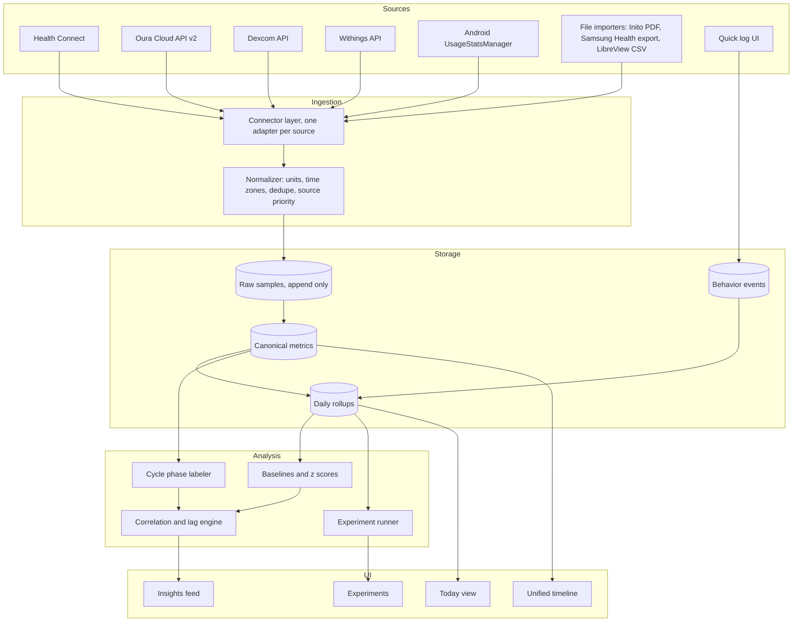

# Life Powers: Personal Health Picture

A design for an app that pulls together every biometric and behavioral data stream you already
generate, puts it on one timeline, and shows which of your daily choices actually move your numbers.

Companion documents:

- [Data sources and integration paths](DATA_SOURCES.md)
- [Canonical data model](DATA_MODEL.md)

---

## 1. What the app is for

You have seven streams of data about your body and your habits, each locked in its own vendor app:

| Stream | Device | What it tells you |
|---|---|---|
| Sleep, HRV, resting HR, temperature, readiness | Oura Ring | Recovery and nervous system state |
| Hormones (LH, estrogen, progesterone metabolite, FSH) | Inito monitor (assumed, see open questions) | Cycle phase, the biggest hidden variable behind everything else |
| Steps, workouts, HR, SpO2, body composition | Galaxy Watch via Samsung Health | Activity and training load |
| Continuous glucose | CGM (Dexcom, Stelo, or Libre) | Metabolic response to food, sleep, and stress |
| Weight, body fat, muscle mass | Smart scale | Slow trend outcome |
| Systolic, diastolic, pulse | Smart BP monitor | Cardiovascular outcome |
| Phone usage by app and hour | Android usage stats | Behavior, especially late night screen time |

None of these apps can see the others. The question you want answered is not "what was my sleep
score" but "what did I do on the days my sleep score was good, and does that hold up over months."

The app answers three questions:

1. **How am I doing?** One daily view of recovery, metabolic, cardiovascular, and body trend signals.
2. **What drives it?** Which behaviors (bedtime, alcohol, late eating, screen time, training, cycle phase)
   correlate with changes in each outcome, after accounting for the things that confound them.
3. **What should I try?** Self experiments the app can set up, run, and score for you.

---

## 2. Design principles

**Local first.** Your health data lives on your phone in an encrypted database. No account, no server,
no third party sees the combined picture. Vendor cloud APIs are called from the phone. Backups are an
encrypted file you control.

**Health Connect is the hub, vendor APIs are the enrichment.** On Android, Oura, Samsung Health,
Dexcom and Stelo, most smart scales, and most BP monitors already write to Health Connect. Reading
Health Connect gets you about 80 percent of the data with one permission screen and no API keys.
Direct vendor APIs are added only where they expose something Health Connect does not (Oura readiness
contributors and tags, Dexcom event logs, Withings body composition detail).

**Behavior is first class data.** Devices measure outcomes well and causes badly. The app needs a fast
way to log the causes: alcohol, caffeine after noon, meal times, supplements, travel, illness,
stressful events. Oura tags and Dexcom events import automatically. Everything else is a two tap entry.

**Within person statistics only.** Population reference ranges are shown for context but every insight
is computed against your own baseline. "Your HRV was 12 percent below your 30 day median" is useful.
"Your HRV is normal for your age" is not.

**Cycle phase is a dimension, not a metric.** HRV, resting HR, skin temperature, glucose, sleep, and
BP all shift predictably across a menstrual cycle. Every correlation the app computes is stratified by
phase (follicular, ovulatory, luteal, menstrual) so a real effect is not hidden by a hormonal one, and a
hormonal one is not mistaken for a behavioral one.

**Honest about evidence.** Every insight carries a sample size, an effect size, and a confidence band.
The app says "not enough data yet" far more often than it says "this causes that."

---

## 3. Architecture

### 3.1 Connector layer

Each source gets an adapter with the same interface: `sync(since)` returns normalized samples and a
new cursor. Adapters are scheduled by WorkManager, run when the phone is charging and on Wi-Fi by
default, and can be triggered by hand. Each adapter records its last successful sync so the Today view
can show "Oura: synced 20 minutes ago, CGM: stale since yesterday."

Health Connect has one constraint that shapes the design: an app can only read from it while in the
foreground. The adapter therefore reads on app open and via a foreground service notification during
scheduled syncs, using the Health Connect change log so each read is incremental.

### 3.2 Normalizer

The normalizer turns every vendor shape into one canonical sample: metric, value, unit, start time,
end time, source, source record id. It handles:

- Unit conversion (mg/dL vs mmol/L, kg vs lb, Celsius vs Fahrenheit deviation).
- Time zone pinning. Every sample stores UTC plus the zone offset it was recorded in, so a trip does
  not corrupt "bedtime."
- Deduplication when the same measurement arrives twice, for example Oura sleep via Health Connect
  and via the Oura API. A per metric source priority list decides which copy is canonical; the other is
  kept in raw storage.
- Day assignment. A "day" for sleep metrics is the night ending on that date. A "day" for glucose is
  midnight to midnight local. The rule is stored per metric, not hard coded.

### 3.3 Storage

SQLite via Room with SQLCipher encryption. Four tables matter (full schema in DATA_MODEL.md):

- `raw_sample`: append only, exactly what the vendor sent, for reprocessing.
- `metric_sample`: canonical, deduplicated, one row per measurement.
- `daily_metric`: one row per metric per day with the aggregate that metric needs (mean, min, max,
  sum, time in range, count). This is what the insights engine reads.
- `behavior_event`: timestamped events with a type, optional quantity, and free text.

Expected volume for one person: CGM alone is about 100k samples per year, heart rate from the watch
and ring together another 500k. SQLite handles this comfortably on a phone. Daily rollups keep the
analysis queries fast regardless of raw volume.

### 3.4 Analysis engine

Runs on device, nightly after sync, and on demand.

**Baselines.** For every daily metric: rolling 7, 30, and 90 day median and interquartile range.
Every day gets a z score against the 30 day window. This is the unit all insights are expressed in.

**Cycle phase labeler.** Uses Inito hormone values when present (LH surge marks ovulation,
progesterone metabolite rise confirms luteal). Falls back to Oura temperature trend and cycle length
history when a cycle has no hormone tests. Produces a phase label per day plus a confidence.

**Correlation and lag engine.** For each (behavior or input metric, outcome metric) pair:

1. Build the paired daily series with lags of 0, 1, and 2 days (did last night's alcohol affect
   today's HRV, did yesterday's steps affect tonight's deep sleep).
2. Stratify by cycle phase and by weekday versus weekend.
3. Compute Spearman correlation and a simple effect size (median outcome on days with the behavior
   versus without, in z score units).
4. Require a minimum of 14 paired days per stratum before anything is shown, and 30 before it is
   shown without a "preliminary" label.
5. Control the false discovery rate across all pairs tested so the feed does not fill with noise.

**Experiment runner.** You pick a behavior and an outcome ("no screens after 9pm" and "sleep onset
latency"). The app assigns alternating blocks of days, reminds you which condition today is, scores
the result when enough days are in, and reports the effect in plain language with the sample size.

### 3.5 UI

Four screens.

**Today.** Recovery (Oura readiness, HRV z score, resting HR), metabolic (overnight glucose mean,
time in range, largest spike yesterday), cardiovascular (latest BP, 7 day trend), body (weight 7 day
average, trend arrow), behavior (screen time yesterday, last screen use before sleep, logged events),
cycle phase. Each tile shows its own data freshness.

**Timeline.** Every stream on a shared time axis, zoomable from a single day to a year. A day view
lines up glucose curve, heart rate, sleep stages, screen use blocks, and logged events so you can see
that the 11pm snack produced the 2am glucose bump and the shallow sleep after it.

**Insights.** A feed of findings ranked by effect size and confidence, each showing the paired
scatter, the sample size, the cycle phase breakdown, and a one line interpretation. Dismissable and
pinnable.

**Experiments.** Set up, run, and review self experiments.

---

## 4. Insights the data can actually support

Grouped by outcome, with the inputs the app has for each. These are the concrete analyses the
engine runs, not aspirations.

**Sleep and recovery (Oura).**
Inputs: last screen use time, total evening screen time, alcohol, caffeine after noon, last meal
time, workout timing and intensity (watch), steps, bedtime consistency, cycle phase, evening glucose.
Outcomes: HRV, resting HR, deep and REM minutes, sleep onset latency, readiness, skin temperature
deviation.

**Glucose (CGM).**
Inputs: meal events, sleep duration and quality the night before, workout timing, steps in the two
hours after a meal, stress score, cycle phase (luteal insulin resistance is measurable).
Outcomes: overnight mean, fasting glucose, post meal peak and return time, time in range, glucose
variability.

**Blood pressure.**
Inputs: sleep the night before, alcohol, sodium if logged, workout, HRV, weight trend, cycle phase,
time of day of the reading.
Outcomes: morning systolic and diastolic, weekly mean, reading to reading variability. BP readings
are sparse, so this analysis uses weekly aggregates and needs months of data.

**Body composition.**
Inputs: weekly averages of everything above.
Outcomes: 7 day weight average, body fat trend, muscle mass trend. Daily weight is noise, so the
app never shows a single day's weight as a finding.

**Hormones as a lens, not an outcome.**
The hormone stream is used mostly to label phase. The app also shows your own HRV, temperature,
resting HR, sleep, and glucose profile across an average cycle, so you learn your personal pattern
and stop reading luteal phase changes as problems.

---

## 5. Privacy and security

- All data encrypted at rest on device with a key held in the Android Keystore.
- No analytics, no crash reporting that includes health data, no network calls except to the vendor
  APIs you connect.
- OAuth tokens stored in the Keystore backed EncryptedSharedPreferences.
- Export at any time to CSV or JSON. Delete everything with one action.
- Backups are an encrypted archive you save to your own Drive or a cable. The app never holds a
  cloud copy.
- If the app is ever extended to other people (clients, family), that is a different product with
  consent flows, per user encryption, and possibly HIPAA obligations. Design for one user now and
  do not let that boundary blur.

---

## 6. Recommended stack

| Layer | Choice | Why |
|---|---|---|
| Platform | Android, Kotlin, Jetpack Compose | Health Connect and UsageStatsManager are Android native. Galaxy Watch rules out iOS as primary. |
| Storage | Room over SQLCipher | Encrypted, offline, well supported. |
| Background work | WorkManager plus a foreground sync service | Health Connect reads need foreground. |
| Health Connect | androidx.health.connect client | Covers Oura, Samsung Health, Dexcom, Stelo, scales, BP cuffs. |
| Vendor APIs | Oura v2 (personal access token), Dexcom (OAuth), Withings (OAuth) | Only for data Health Connect lacks. |
| Charts | Vico or a Compose Canvas layer | Timeline needs a custom shared axis. |
| Statistics | Pure Kotlin, Apache Commons Math for rank correlation and FDR | Small enough to run nightly on device. |
| Cycle inference | Rule based, see section 3.4 | Transparent beats a black box for your own body. |

Alternative: Flutter would allow an iOS build later, but Health Connect and usage stats would still
require Android platform channels, and the iOS versions (HealthKit, Screen Time API) have a different
and more restrictive shape. Build native Android first.

A backend is not required. Oura personal access tokens and Dexcom's OAuth can be completed on the
phone. The one case that needs a public URL is Oura or Withings webhooks, and polling every few hours
is good enough for a personal app.

---

## 7. Roadmap

**Phase 0, two weeks: prove the insights before building the app.**
Export a few months from each vendor (Oura CSV, Samsung Health download, Dexcom or LibreView CSV,
Inito PDF, scale app export, phone screen time by hand). Load into a notebook. Run the baseline and
correlation logic from section 3.4 by hand. If nothing interesting falls out of 90 days of data, the
app design needs rethinking before a line of Android code is written. If it does, those findings
become the first items in the Insights feed and prove the value.

**Phase 1, six to eight weeks: Health Connect plus quick log.**
Android app, encrypted store, Health Connect adapter for every type it carries, Oura API adapter for
readiness contributors and tags, UsageStats adapter for screen time, quick log for behaviors, Today
and Timeline screens. Daily rollups and baselines. No insights yet beyond z scores.

**Phase 2, four weeks: cycle phase and insights.**
Inito PDF importer and manual hormone entry, phase labeler, correlation engine with lags and
stratification, Insights feed.

**Phase 3, four weeks: experiments and depth.**
Experiment runner. CGM vendor API for event data if using Dexcom. Withings API if the scale or cuff
is Withings. Encrypted backup and restore. Export.

**Later.** Optional iOS build, optional sharing of a PDF summary with a clinician, optional LLM layer
that writes a weekly narrative from the insights table (never from raw data, and only on device or
with explicit opt in).

---

## 8. Open questions

These change the integration work, not the architecture. Answer them in any order.

1. **Hormone monitor.** "Intuit hormone data" is read here as the Inito fertility monitor, which
   measures LH, estrogen (E3G), progesterone metabolite (PdG), and FSH from urine strips. If it is a
   different device (Mira, Proov, a lab panel), the import path changes. Inito has no public API and
   exports a PDF report from the Chart screen, so the plan is a PDF parser plus manual entry.
2. **Which CGM.** Dexcom G7 and Stelo write to Health Connect (with roughly a three hour delay on
   Stelo) and Dexcom has a public API with meal and exercise events. Abbott Libre 3 does not have a
   confirmed Health Connect integration and LibreView offers CSV export only, so the plan would be a
   CSV importer. Knowing the brand picks the adapter.
3. **Scale and BP cuff brands.** Withings has a full public API with webhooks. Most other brands
   (Renpho, Eufy, Omron, Qardio) reach the app through Health Connect only. Both work, the question is
   whether body composition detail beyond weight and body fat is available.
4. **Phone.** The design assumes an Android phone paired with the Galaxy Watch. If you carry an
   iPhone as well, screen time and some device syncs split across two phones and the design needs a
   second ingestion path.
5. **Who uses it.** This is designed for one person. If the intent is a tool for your practice or your
   clients, section 5 applies and the roadmap gains a consent and multi user phase before Phase 1.
