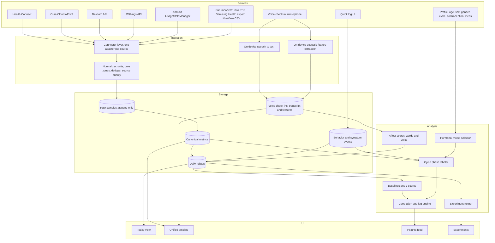

# Life Powers: Personal Health Picture

A design for an app that pulls together every biometric and behavioral data stream you already
generate, puts it on one timeline, adds a daily voice check-in that hears how you feel, and shows
which of your daily choices actually move your numbers.

Companion documents:

- [Data sources and integration paths](DATA_SOURCES.md)
- [Canonical data model](DATA_MODEL.md)

---

## 1. What the app is for

You have eight streams of data about your body and your habits, each locked in its own vendor app or
not captured at all:

| Stream | Device | What it tells you |
|---|---|---|
| Sleep, HRV, resting HR, temperature, readiness | Oura Ring | Recovery and nervous system state |
| Hormones (LH, estrogen, progesterone metabolite, FSH) | Inito monitor (assumed, see open questions) | Cycle phase, the biggest hidden variable behind everything else |
| Steps, workouts, HR, SpO2, body composition | Galaxy Watch via Samsung Health | Activity and training load |
| Continuous glucose | CGM (Dexcom, Stelo, or Libre) | Metabolic response to food, sleep, and stress |
| Weight, body fat, muscle mass | Smart scale | Slow trend outcome |
| Systolic, diastolic, pulse | Smart BP monitor | Cardiovascular outcome |
| Phone usage by app and hour | Android usage stats | Behavior, especially late night screen time |
| How you feel, in your words and in your voice | Daily voice check-in (built into the app) | Mood, energy, and tension, including what you do not notice yourself |

None of these apps can see the others. The question you want answered is not "what was my sleep
score" but "what did I do on the days my sleep score was good, and does that hold up over months."

The app answers three questions:

1. **How am I doing?** One daily view of recovery, metabolic, cardiovascular, body, and emotional
   signals.
2. **What drives it?** Which behaviors (bedtime, alcohol, late eating, screen time, training,
   cycle phase) correlate with changes in each outcome, after accounting for the things that confound
   them.
3. **What should I try?** Self experiments the app can set up, run, and score for you.

---

## 2. Design principles

**Local first.** Your health data lives on your phone in an encrypted database. No account, no server,
no third party sees the combined picture. Vendor cloud APIs are called from the phone. Backups are an
encrypted file you control.

**Health Connect is the hub, vendor APIs are the enrichment.** On Android, Oura, Samsung Health,
Dexcom and Stelo, most smart scales, and most BP monitors already write to Health Connect. Reading
Health Connect gets you about 80 percent of the data with one permission screen and no API keys.
Direct vendor APIs are added only where they expose something Health Connect does not (Oura readiness
contributors and tags, Dexcom event logs, Withings body composition detail).

**Behavior is first class data.** Devices measure outcomes well and causes badly. The app needs a fast
way to log the causes: alcohol, caffeine after noon, meal times, supplements, travel, illness,
stressful events, symptoms. Oura tags and Dexcom events import automatically. Everything else is a
two tap entry or a sentence in the voice check-in.

**Within person statistics only.** Population reference ranges are shown for context but every insight
is computed against your own baseline. "Your HRV was 12 percent below your 30 day median" is useful.
"Your HRV is normal for your age" is not.

**Hormonal context comes from the person, not just the test strips.** Age, sex, gender, menstrual
status, contraception, hormone therapy, and relevant medications are collected once in a profile and
they decide which hormonal model the app runs. A person on a combined pill has no ovulatory cycle to
label. A person in perimenopause has cycles the calendar cannot predict. A person on testosterone has
a dosing rhythm instead of a cycle. The same hormone strip reading means different things in each
case, and the app must know which case it is in.

**Cycle phase is a dimension, not a metric.** HRV, resting HR, skin temperature, glucose, sleep, BP,
and voice all shift predictably across a menstrual cycle. Every correlation the app computes is
stratified by phase so a real effect is not hidden by a hormonal one, and a hormonal one is not
mistaken for a behavioral one.

**Honest about evidence.** Every insight carries a sample size, an effect size, and a confidence band.
The app says "not enough data yet" far more often than it says "this causes that." This applies
doubly to emotion read from voice: the app reports what changed in your voice compared with your own
usual, never a diagnosis.

---

## 3. Architecture

### 3.1 Connector layer

Each source gets an adapter with the same interface: `sync(since)` returns normalized samples and a
new cursor. Adapters are scheduled by WorkManager, run when the phone is charging and on Wi-Fi by
default, and can be triggered by hand. Each adapter records its last successful sync so the Today view
can show "Oura: synced 20 minutes ago, CGM: stale since yesterday."

Health Connect has one constraint that shapes the design: an app can only read from it while in the
foreground. The adapter therefore reads on app open and via a foreground service notification during
scheduled syncs, using the Health Connect change log so each read is incremental.

### 3.2 Normalizer

The normalizer turns every vendor shape into one canonical sample: metric, value, unit, start time,
end time, source, source record id. It handles:

- Unit conversion (mg/dL vs mmol/L, kg vs lb, Celsius vs Fahrenheit deviation).
- Time zone pinning. Every sample stores UTC plus the zone offset it was recorded in, so a trip does
  not corrupt "bedtime."
- Deduplication when the same measurement arrives twice, for example Oura sleep via Health Connect
  and via the Oura API. A per metric source priority list decides which copy is canonical; the other is
  kept in raw storage.
- Day assignment. A "day" for sleep metrics is the night ending on that date. A "day" for glucose is
  midnight to midnight local. The rule is stored per metric, not hard coded.

### 3.3 Storage

SQLite via Room with SQLCipher encryption. The tables that matter (full schema in DATA_MODEL.md):

- `raw_sample`: append only, exactly what the vendor sent, for reprocessing.
- `metric_sample`: canonical, deduplicated, one row per measurement.
- `daily_metric`: one row per metric per day with the aggregate that metric needs (mean, min, max,
  sum, time in range, count). This is what the insights engine reads.
- `behavior_event`: timestamped events with a type, optional quantity, and free text. Symptoms live
  here too.
- `voice_checkin`: one row per recording with transcript, acoustic feature vector, and derived scores.
- `user_profile` and `profile_change`: the person's hormonal and demographic context, with dated
  history so a contraception change on a given date splits the analysis correctly.

Expected volume for one person: CGM alone is about 100k samples per year, heart rate from the watch
and ring together another 500k. Voice features are tiny, under 1 KB per check-in. SQLite handles this
comfortably on a phone. Daily rollups keep the analysis queries fast regardless of raw volume.

### 3.4 Analysis engine

Runs on device, nightly after sync, and on demand.

**Baselines.** For every daily metric: rolling 7, 30, and 90 day median and interquartile range.
Every day gets a z score against the 30 day window. This is the unit all insights are expressed in.

**Hormonal model selector.** Reads the profile and picks one of the models in section 4. The choice
decides whether a cycle phase dimension exists at all, how the phase labeler weighs hormone strips
versus temperature versus calendar, and which stratifications the correlation engine uses.

**Cycle phase labeler.** For a naturally cycling person: uses Inito hormone values when present (LH
surge marks ovulation, progesterone metabolite rise confirms luteal), falls back to Oura temperature
trend and cycle length history when a cycle has no hormone tests, and uses symptom timing as weak
supporting evidence. Produces a phase label per day plus a confidence. Other hormonal models replace
this with the appropriate rhythm (pill pack week, injection week) or turn it off.

**Affect scorer.** Turns each voice check-in into daily affect metrics from two channels, the words
and the sound. Section 5 describes it.

**Correlation and lag engine.** For each (behavior or input metric, outcome metric) pair:

1. Build the paired daily series with lags of 0, 1, and 2 days (did last night's alcohol affect
   today's HRV, did yesterday's steps affect tonight's deep sleep).
2. Stratify by hormonal phase where the model has one, and by weekday versus weekend.
3. Compute Spearman correlation and a simple effect size (median outcome on days with the behavior
   versus without, in z score units).
4. Require a minimum of 14 paired days per stratum before anything is shown, and 30 before it is
   shown without a "preliminary" label.
5. Control the false discovery rate across all pairs tested so the feed does not fill with noise.

**Experiment runner.** You pick a behavior and an outcome ("no screens after 9pm" and "sleep onset
latency"). The app assigns alternating blocks of days, reminds you which condition today is, scores
the result when enough days are in, and reports the effect in plain language with the sample size.

### 3.5 UI

Four screens plus the check-in.

**Today.** Recovery (Oura readiness, HRV z score, resting HR), metabolic (overnight glucose mean,
time in range, largest spike yesterday), cardiovascular (latest BP, 7 day trend), body (weight 7 day
average, trend arrow), behavior (screen time yesterday, last screen use before sleep, logged events),
hormonal phase, and how you sounded this morning compared with your usual. Each tile shows its own
data freshness.

**Check-in.** A single large record button, a rotating prompt, a 30 to 60 second recording, then a
short reflection card: what you said, how your voice compared with your baseline, and a one tap
confirmation of any behaviors or symptoms the transcript mentioned ("you mentioned a glass of wine
last night, log it?").

**Timeline.** Every stream on a shared time axis, zoomable from a single day to a year. A day view
lines up glucose curve, heart rate, sleep stages, screen use blocks, check-in markers, and logged
events so you can see that the 11pm snack produced the 2am glucose bump and the shallow sleep after
it.

**Insights.** A feed of findings ranked by effect size and confidence, each showing the paired
scatter, the sample size, the phase breakdown, and a one line interpretation. Dismissable and
pinnable.

**Experiments.** Set up, run, and review self experiments.

---

## 4. Profile and hormonal context

### 4.1 What the profile collects

Collected once at setup, editable any time, and every change is dated so the engine knows which
period of data each setting applies to.

| Field | Why it matters |
|---|---|
| Date of birth | Age shapes expected HRV, resting HR, sleep architecture, BP thresholds, voice pitch, and the likelihood of perimenopause. Used for context and flag thresholds, never for scoring. |
| Sex assigned at birth | Decides whether a menstrual cycle model is even a candidate, and which reference contexts apply. |
| Gender identity | Stored separately from sex. Governs how the app addresses you and which features are shown, not physiology. Optional. |
| Gender affirming hormone therapy | Type (estradiol, testosterone, blockers), route, and dosing schedule. Replaces the cycle model with a dosing rhythm. |
| Menstrual status | Regular cycles, irregular cycles, perimenopause, postmenopause, amenorrhea, pregnant, postpartum or breastfeeding, not applicable. |
| Typical cycle length and variability | Seeds the calendar fallback and sets how much to trust it. |
| Date of last period start | Anchors the current cycle on day one. |
| Contraception | None, combined pill, progestin only pill, hormonal IUD, copper IUD, implant, injection, ring, patch, other. Start and stop dates. |
| Hormone replacement therapy | Type and schedule, for perimenopause and postmenopause. |
| Relevant medications | Thyroid, SSRIs and SNRIs, beta blockers, stimulants, sleep aids, GLP-1 agonists. Each moves HR, HRV, BP, glucose, sleep, or weight, and a start or dose change must be a visible marker on the timeline so a shift is not misread as a behavior effect. |

### 4.2 Hormonal models

The selector maps the profile to one of these. Each model defines whether a phase dimension exists,
what labels it has, and how the labeler assigns them.

| Situation | Model | Phase labels | Labeler evidence, in order of weight |
|---|---|---|---|
| Naturally cycling, regular | Natural cycle | menstrual, follicular, ovulatory, luteal | Hormone strips, temperature pattern, symptoms, calendar |
| Naturally cycling, irregular or perimenopause | Natural cycle, low calendar trust | same four plus unknown | Hormone strips, temperature pattern, symptoms. Calendar fallback disabled once cycle length variability exceeds a threshold. FSH trend shown as its own metric. |
| Copper IUD | Natural cycle | same as above | same as above |
| Combined pill, ring, or patch | Pack rhythm | active hormone week 1, 2, 3, hormone free interval | Pack calendar from the profile. Ovulation is suppressed, so LH and PdG strips are flagged as not interpretable in the usual way. Temperature pattern is expected to be flat. |
| Progestin only pill, implant, injection, hormonal IUD | Suppressed or uncertain cycle | ovulatory cycle if hormone strips show one, otherwise no phase dimension | Hormone strips only. Some people ovulate on these methods and some do not. The labeler says "unknown" rather than guessing. Injection schedule becomes a dosing rhythm. |
| Postmenopause, amenorrhea, no cycle, male | No cycle | none | Phase dimension off. Any hormone lab values are stored as sparse metrics and trended. |
| Gender affirming hormones or HRT | Dosing rhythm | days since dose, bucketed | Dosing events logged as behaviors. Metrics stratified by position in the dosing interval. |
| Pregnant or postpartum | Gestational or postpartum weeks | week number | Due date or delivery date from the profile. Many baselines reset. The app widens its confidence bands and labels this period explicitly. |

### 4.3 Symptoms as hormonal cues

A symptom log with severity 1 to 5: cramps, bloating, breast tenderness, headache or migraine, hot
flashes, night sweats, mood swings, irritability, anxiety, low libido, acne, fatigue, brain fog,
insomnia, food cravings. Symptoms can be tapped in, or spoken during the check-in and confirmed.

Symptoms serve two roles. They are outcomes (what predicts a migraine day) and they are weak evidence
for the phase labeler (premenstrual symptom clusters support a late luteal label when strips are
missing). They also surface the person's own pattern across a cycle, so recurring luteal irritability
is seen for what it is rather than read as a bad week.

---

## 5. Voice check-in

### 5.1 What it does

Once a day, ideally at the same time, you answer a short prompt out loud for 30 to 60 seconds. "How
are you feeling right now?" "What is on your mind today?" "How did last night go?" The prompts rotate
within a fixed set so recordings stay comparable.

The app listens on two channels:

**Words.** What you say about yourself. On device speech recognition produces a transcript. From the
transcript the app extracts any direct self report ("I feel tired", "energy is maybe a six"), the
behaviors and symptoms you mention, and a set of language markers that research links to mood and
anxiety: rates of positive and negative emotion words, first person singular pronoun rate, absolutist
words ("always", "never", "completely"), future orientation and agency words ("plan", "going to",
"looking forward"), and hedging or worry phrases. With your explicit opt in, the transcript (never the
audio) can also be sent to a cloud language model that returns structured ratings for energy,
optimism, anxiety, sadness, and irritability with a quoted phrase as evidence for each. Without opt
in, an on device lexicon scorer produces the same fields with less nuance.

**Voice.** How you sound, independent of the words. On device acoustic analysis extracts a standard
paralinguistic feature set (the extended Geneva minimalistic acoustic parameter set, 88 features, or
an equivalent): pitch mean and range, pitch variability, loudness and loudness dynamics, speaking rate,
articulation rate, pause count and mean pause length, voiced fraction, jitter, shimmer, harmonics to
noise ratio, and spectral shape. An optional on device speech emotion model adds arousal and valence
estimates.

### 5.2 Why within person only

Speech emotion recognition across different people is not reliable enough to tell you how you feel in
absolute terms. Published models reach moderate accuracy on acted datasets and worse on real
recordings, and pitch, loudness, and voice quality vary with the microphone, the room, a cold, the
time of day, cycle phase, age, and hormonal contraception. Any app that says "you sound 72 percent
sad" is overclaiming.

What is tractable is change detection against your own voice. The design therefore:

- Builds a personal baseline from your first 14 check-ins before showing any voice derived signal.
- Recommends the same phone, the same prompt set, and roughly the same time of day.
- Expresses every voice signal as a z score against your trailing 30 day window, exactly like every
  other metric in the app.
- Stratifies the baseline by hormonal phase once there is enough data, because voice pitch and
  quality shift across a cycle.
- Flags recordings with poor signal (background noise, very short speech, a cold logged as a symptom)
  and excludes them from baselines.

### 5.3 Derived daily metrics

| Metric | Built from | Reads as |
|---|---|---|
| voice.energy_index | loudness, speaking rate, pitch range, composite z | Vocal energy versus your usual |
| voice.flatness_index | reduced pitch variability, reduced loudness dynamics, slower rate, longer pauses | Markers that cluster with low mood and fatigue |
| voice.tension_index | higher pitch mean, higher jitter and shimmer, faster rate, shorter pauses, lower harmonics to noise | Markers that cluster with arousal and anxiety |
| voice.arousal, voice.valence | optional on device emotion model | Dimensional affect estimate, low weight |
| words.energy_self_report | explicit statements in the transcript | What you said your energy was |
| words.valence | emotion word balance or language model rating | How positive your description was |
| words.optimism | future orientation and agency markers or language model rating | Forward looking versus stuck |
| words.anxiety_markers | worry phrases, hedging, absolutist words or language model rating | Anxious language |
| words.self_focus | first person singular rate | Inward focus, a known marker of low mood when elevated |

### 5.4 The gap between words and voice

The most useful signal is disagreement. When the words say fine and the voice does not, the app
notices. The rule:

- words.valence at or above your baseline, and
- voice.flatness_index or voice.tension_index at least 1.5 standard deviations beyond your baseline,
- on two or more of the last three check-ins.

When that fires, the Today view shows a quiet card, phrased as an observation and a question, never a
label: "You have described the last couple of days as fine. Your voice has been flatter and slower
than usual. Worth a moment?" The card links to the timeline so you can see what else was happening
(short sleep, luteal phase, a heavy week of screen time) and to the check-in so you can say more if
you want to.

The same mechanism works in the other direction: a tense voice on days you report feeling calm, or a
sustained lift in vocal energy during an experiment you are running.

### 5.5 How it joins the rest of the app

Every voice and words metric enters the daily rollup like any other metric. The correlation engine
then answers questions such as: what predicts a flat voice day (short sleep, low HRV, late screen
time, luteal phase, high overnight glucose), and what follows a tense voice day (higher morning BP,
worse sleep that night). Voice metrics are both outcomes and inputs.

Behaviors and symptoms spoken in the check-in are offered for one tap confirmation and then stored as
events, so the check-in doubles as the fastest way to log.

### 5.6 Safety and limits

- The app is not a clinical instrument and says so in the check-in screen. Signals are observations
  about change in your own voice and language, not diagnoses.
- If a transcript contains language about self harm or crisis, the app shows crisis resources
  immediately and plainly, outside the chart and insight machinery, and does not score that recording
  as a data point.
- Raw audio is processed on the phone. By default the audio file is deleted once the transcript and
  feature vector are stored. You can choose to keep encrypted audio. Nothing leaves the device unless
  you opt in to cloud transcript analysis, and that opt in sends text only.
- The check-in is skippable. A missed day is a missing value, not a penalty.

---

## 6. Insights the data can actually support

Grouped by outcome, with the inputs the app has for each. These are the concrete analyses the
engine runs, not aspirations.

**Sleep and recovery (Oura).**
Inputs: last screen use time, total evening screen time, alcohol, caffeine after noon, last meal
time, workout timing and intensity (watch), steps, bedtime consistency, hormonal phase, evening
glucose, prior day voice tension.
Outcomes: HRV, resting HR, deep and REM minutes, sleep onset latency, readiness, skin temperature
deviation.

**Glucose (CGM).**
Inputs: meal events, sleep duration and quality the night before, workout timing, steps in the two
hours after a meal, stress score, hormonal phase (luteal insulin resistance is measurable).
Outcomes: overnight mean, fasting glucose, post meal peak and return time, time in range, glucose
variability.

**Blood pressure.**
Inputs: sleep the night before, alcohol, sodium if logged, workout, HRV, weight trend, hormonal
phase, time of day of the reading, voice tension that morning.
Outcomes: morning systolic and diastolic, weekly mean, reading to reading variability. BP readings
are sparse, so this analysis uses weekly aggregates and needs months of data.

**Mood, energy, and tension (voice check-in).**
Inputs: sleep metrics, HRV, resting HR, steps, workouts, screen time, alcohol, caffeine, glucose
variability, hormonal phase, symptoms, medication changes.
Outcomes: voice.energy_index, voice.flatness_index, voice.tension_index, words.valence,
words.optimism, and the words versus voice gap.

**Body composition.**
Inputs: weekly averages of everything above.
Outcomes: 7 day weight average, body fat trend, muscle mass trend. Daily weight is noise, so the
app never shows a single day's weight as a finding.

**Hormones as a lens, not an outcome.**
The hormone stream is used mostly to label phase. The app also shows your own HRV, temperature,
resting HR, sleep, glucose, voice, and symptom profile across an average cycle or dosing interval, so
you learn your personal pattern and stop reading luteal phase changes as problems.

---

## 7. Privacy and security

- All data encrypted at rest on device with a key held in the Android Keystore.
- No analytics, no crash reporting that includes health data, no network calls except to the vendor
  APIs you connect and, if opted in, the transcript analysis service.
- OAuth tokens stored in the Keystore backed EncryptedSharedPreferences.
- Audio processed on device and deleted by default after feature extraction.
- Export at any time to CSV or JSON. Delete everything with one action.
- Backups are an encrypted archive you save to your own Drive or a cable. The app never holds a
  cloud copy.
- If the app is ever extended to other people (clients, family), that is a different product with
  consent flows, per user encryption, and possibly HIPAA obligations. The voice check-in in
  particular would need clinical review before being offered to clients. Design for one user now and
  do not let that boundary blur.

---

## 8. Recommended stack

| Layer | Choice | Why |
|---|---|---|
| Platform | Android, Kotlin, Jetpack Compose | Health Connect and UsageStatsManager are Android native. Galaxy Watch rules out iOS as primary. |
| Storage | Room over SQLCipher | Encrypted, offline, well supported. |
| Background work | WorkManager plus a foreground sync service | Health Connect reads need foreground. |
| Health Connect | androidx.health.connect client | Covers Oura, Samsung Health, Dexcom, Stelo, scales, BP cuffs. |
| Vendor APIs | Oura v2 (personal access token), Dexcom (OAuth), Withings (OAuth) | Only for data Health Connect lacks. |
| Speech to text | Android on device SpeechRecognizer, or whisper.cpp with a small model bundled | Offline, no audio leaves the phone. |
| Acoustic features | openSMILE compiled for Android (eGeMAPS), or a Kotlin port of the needed features | openSMILE's license permits research and personal use; a commercial release would need a license or the Kotlin port. |
| Speech emotion model | Optional TensorFlow Lite model for arousal and valence | Low weight signal, can ship later. |
| Transcript interpretation | On device lexicon scorer by default. Optional cloud language model (Claude Opus 5.5, model id claude-opus-5-5) with explicit opt in, transcript only. | Nuance when wanted, privacy by default. |
| Charts | Vico or a Compose Canvas layer | Timeline needs a custom shared axis. |
| Statistics | Pure Kotlin, Apache Commons Math for rank correlation and FDR | Small enough to run nightly on device. |
| Hormonal models | Rule based, see section 4 | Transparent beats a black box for your own body. |

Alternative: Flutter would allow an iOS build later, but Health Connect and usage stats would still
require Android platform channels, and the iOS versions (HealthKit, Screen Time API) have a different
and more restrictive shape. Build native Android first.

A backend is not required. Oura personal access tokens and Dexcom's OAuth can be completed on the
phone. The one case that needs a public URL is Oura or Withings webhooks, and polling every few hours
is good enough for a personal app.

---

## 9. Roadmap

There is no preparation phase. You install the app, connect your accounts, fill in the profile, and
record your first check-in. Everything else accumulates on its own.

**What the first month feels like.**

- Day 1: Oura history back to the day you got the ring arrives through the Oura API. Health Connect
  supplies the recent history it holds for the watch, CGM, scale, and cuff, and more when the app is
  granted the history read permission. The profile is set. The timeline is already populated. First
  voice check-in recorded.
- Day 7: Baselines exist for every metric with daily data. The Today view shows z scores. Screen time
  has a week of history. The voice baseline is half built.
- Day 14: Voice baseline complete, voice signals appear on the Today view. First preliminary
  insights appear for behaviors you have logged at least a handful of times.
- Day 30: Insights lose the preliminary label. First full hormonal cycle labeled if you are cycling.
  First experiment can be started with a real baseline behind it.

**Phase 1, six to eight weeks: foundation.**
Android app, encrypted store, profile and hormonal model selector, Health Connect adapter for every
type it carries, Oura API adapter for readiness contributors and tags, UsageStats adapter for screen
time, quick log for behaviors and symptoms, voice check-in with on device transcription and acoustic
features, Today and Timeline screens, daily rollups and baselines, the words versus voice gap card.

**Phase 2, four weeks: hormonal context and insights.**
Inito PDF importer and manual hormone entry, full phase labeler across all hormonal models,
correlation engine with lags and stratification, Insights feed, cycle or dosing interval overlay
view.

**Phase 3, four weeks: experiments and depth.**
Experiment runner. Optional cloud transcript analysis with opt in. Optional speech emotion model.
CGM vendor API for event data if using Dexcom. Withings API if the scale or cuff is Withings.
Encrypted backup and restore. Export.

**Later.** Optional iOS build, optional sharing of a PDF summary with a clinician, optional weekly
narrative written from the insights table (never from raw data, and only on device or with explicit
opt in).

---

## 10. Open questions

These change the integration work, not the architecture. Answer them in any order.

1. **Hormone monitor.** "Intuit hormone data" is read here as the Inito fertility monitor, which
   measures LH, estrogen (E3G), progesterone metabolite (PdG), and FSH from urine strips. If it is a
   different device (Mira, Proov, a lab panel), the import path changes. Inito has no public API and
   exports a PDF report from the Chart screen, so the plan is a PDF parser plus manual entry.
2. **Which CGM.** Dexcom G7 and Stelo write to Health Connect (with roughly a three hour delay on
   Stelo) and Dexcom has a public API with meal and exercise events. Abbott Libre 3 does not have a
   confirmed Health Connect integration and LibreView offers CSV export only, so the plan would be a
   CSV importer. Knowing the brand picks the adapter.
3. **Scale and BP cuff brands.** Withings has a full public API with webhooks. Most other brands
   (Renpho, Eufy, Omron, Qardio) reach the app through Health Connect only. Both work, the question is
   whether body composition detail beyond weight and body fat is available.
4. **Phone.** The design assumes an Android phone paired with the Galaxy Watch. If you carry an
   iPhone as well, screen time and some device syncs split across two phones and the design needs a
   second ingestion path.
5. **Who uses it.** This is designed for one person. If the intent is a tool for your practice or your
   clients, section 7 applies and the roadmap gains a consent and multi user phase before Phase 1.
6. **Cloud transcript analysis.** Do you want the opt in cloud option built at all, or should the
   words channel stay fully on device? On device is less nuanced but needs no trust decision.
